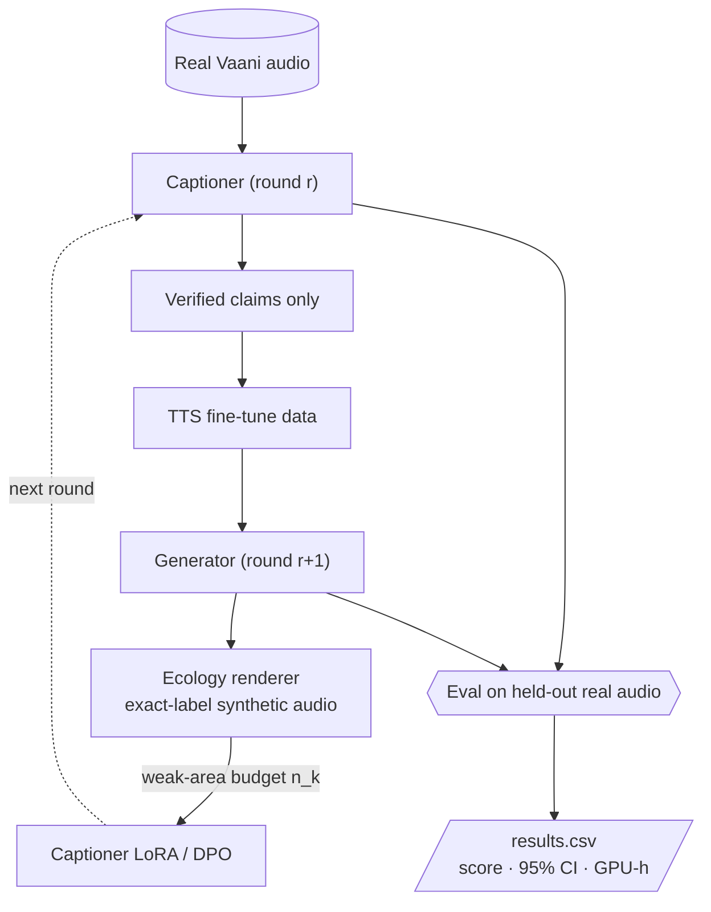
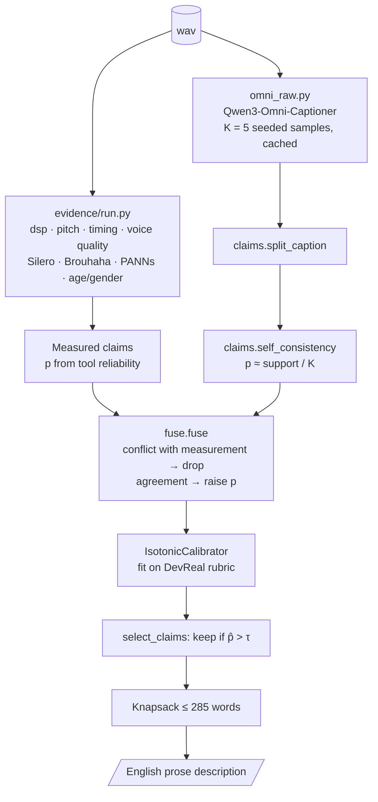
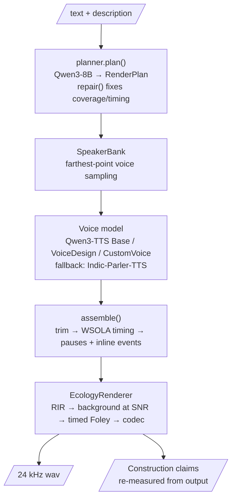
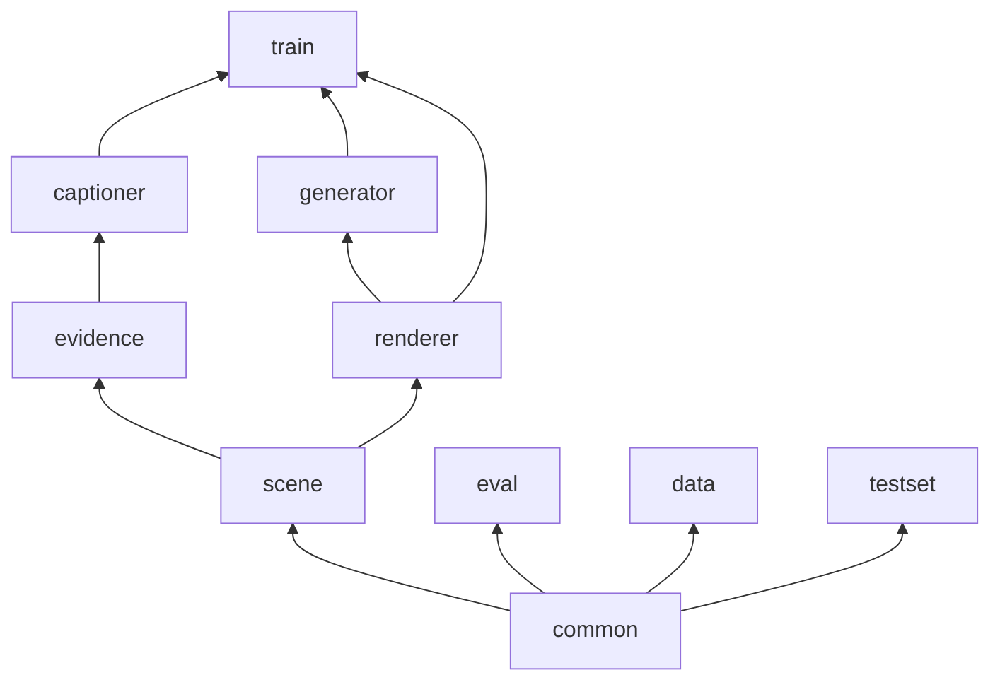

# Architecture: rime-t2

How the pieces fit together. For *why* each design choice was made see `research/` and `docs/LITERATURE.md`;
for *when* to run what see `docs/MIDTERM_RUNBOOK.md`.

---

## 1. System overview

Two models improve each other in rounds. The invariant that keeps the loop from collapsing:

> **Verified Loop.** A claim enters training data only if it is (a) **measured** by a non-learned tool,
> (b) **known by construction** (we rendered/transformed the audio), or (c) **agreed** by $\ge 2$ independent
> sources. Real audio anchors every round; synthetic share ≤ 25 %.

---

## 2. Core data model — `rimet2/scene/schema.py`

Everything passes through one intermediate representation (IR). Captioner *produces* it, generator *consumes* it,
evaluation *scores against* it.

| Type | Fields | Role |
|---|---|---|
| `Claim` | `text, item_type, p, t0, t1, source, value, agree` | one atomic fact; `item_type` ∈ 13 PS rubric types |
| `SceneScore` | `lang, duration_s, claims[], transcript, meta` | captioner output before prose |
| `RenderPlan` | `lang, speaker, global_style, segments[], ecology, coupling[], target_duration_s` | generator plan |
| `Segment` | `text, t0?, style, pause_after_ms, events_inline[]` | one stretch of speech |
| `Ecology` | `channel, codec, clipping, space, background, snr_db, events[]` | recording conditions |
| `EnvEvent` | `label, t0, t1, level_db_rel_speech, query` | timed background sound |

`Claim.source` ∈ {`construction`, `measurement`, `metadata`, `human`, `omni`, `llm`, `model`};
`Claim.verified` is true for the first four or when `agree ≥ 2`.

Prose ↔ IR:
- `scene/verbalize.py`: `SceneScore → prose` (threshold + knapsack, order: recording → voice → timeline → intent).
- `generator/planner.py`: `prose → RenderPlan` (LLM with JSON repair, rule-based fallback).

---

## 3. Captioner pipeline — `rimet2/captioner/`

**Commitment rule.** With $h$ = P(rubric covers the claim), $q$ = P(a false claim is caught),
$w$ = weight gained if true, $w'$ = weight lost if false:

$$\text{state } c \iff \hat p_c > \tau = \frac{q\,w'}{h\,w + q\,w'}$$

**Budget** (greedy on $\hat p_c w_c/\ell_c$):

$$\max_{S}\sum_{c\in S}\hat p_c\,w_c \quad\text{s.t.}\quad \sum_{c\in S}\ell_c \le 300$$

Modes in `captioner/cli.py`: `raw` (round 0 = Omni sample 0 verbatim), `evidence` (tools only), `fused` (full).

---

## 4. Generator pipeline — `rimet2/generator/` + `rimet2/renderer/`

**Diversity** across the 10 samples per item:

$$z_{k+1} = \arg\max_{z\in\mathcal B}\ \min_{j\le k}\bigl(1-\cos(z,z_j)\bigr)\quad\text{s.t. } \cos(z,z_j) < \theta_{SV}$$

with $\theta_{SV}$ from WavLM-SV (0.86) and ECAPA (0.25); constraints relax if the bank is too small.

Systems in `generator/cli.py`: `round0` (official baseline), `parler`, `design` (reference rows), `factored` (ours).

Renderer components:

| Module | Function |
|---|---|
| `rir.py` | Polack / shoebox RIRs, real-RIR bank; RT60 (Schroeder) and C50 measured from the RIR |
| `mix.py` | `add_bed` (returns achieved SNR), `place_event` |
| `channel.py` | ffmpeg codecs: g711, gsm, g722, opus 8k/16k, mp3 32k, amr-nb; channel presets |
| `splice.py` | insert at word gaps with fades, shift label spans |
| `render.py` | `FoleyLibrary` (licensed CSV) + `EcologyRenderer.render(voice, eco, coupling, seed)` |

---

## 5. Self-improvement loop — `rimet2/train/`

| Step | Module | Output |
|---|---|---|
| 1. Pseudo-label real audio, keep verified claims | `captioner` + `Claim.verified` | manifest rows |
| 2. Generator fine-tune data | `build_tts_sft.py` | JSONL `{audio, text, ref_audio, instruct, lang, speaker_id}` |
| 3. Find weak item types | `scripts/eval_captions.py` → `type_scores_*.json` | per-type $F_k$ |
| 4. Allocate synthetic budget | `targeted.allocate` | $n_k = N\,\dfrac{\bar w_k(1-F_k)}{\sum_j \bar w_j(1-F_j)}$ |
| 5. Exact-label synthetic data | `targeted.transform_example`, renderer | audio + construction claims |
| 6. Preference pairs | `pairs.py` (injected false claims, dominance pairs) | DPO pairs |
| 7. Captioner / planner LoRA | `lora_llm.py` | adapters |

**Stopping rule:** stop when the paired $\Delta$ on held-out real audio has a 95% CI containing 0.

---

## 6. Evaluation — `rimet2/eval/` (mirrors the PS)

| Measure | Module | Definition |
|---|---|---|
| Description score | `rubric.py`, `grader.py` | $s=\max\!\Bigl(0,\ \dfrac{\sum_{\text{true stated}}w-\sum_{\text{contradicted}}w-\sum_{\text{false asserted}}w}{\sum_{\text{true}}w}\Bigr)$, spans ±0.25 s, 300-word cut |
| Relevance | `gen_relevance.py` | atomic claims → measurable checks + LLM entailment |
| Diversity | `diversity.py` | connected components of the "same speaker" graph among relevant samples |
| Intelligibility | `cer.py` | IndicConformer RNNT + `textnorm.normalize_for_cer` |
| Naturalness | `naturalness.py` | UTMOS / Audiobox-Aesthetics (relative only) |
| CIs | `common/bootstrap.py` | PS Appendix A: index $=\text{sha256}(\text{seed}\,|\,\text{bootstrap}\,|\,\text{measure}\,|\,r\,|\,j)\bmod n$, $R=1000$, CI = sorted[24], sorted[974] |
| Reporting | `results.py`, `common/ledger.py` | `results.csv`, Pareto plot, GPU-hour ledger |

---

## 7. Data and test sets

- `data/vaani_index.py`: reads parquet metadata only (no audio decode); speaker-disjoint split by
  $\text{sha256}(\texttt{vaani|}\text{speakerID}) \bmod 100$: dev $<2$, test $<4$, else train.
- `data/vaani_tags.py`: transcript cleaning (PS Track-1 rules) and event tags.
- `testset/package.py`: validates and zips the contributed test set (30 clips/lang, ≤30 s, mono ≥16 kHz,
  ≤5 clips/speaker, ≥6 speakers, ≤300-word descriptions).
- `common/manifest.py`: every example carries `source_dataset, licence, text_labeler, description_labeler,
  transform_chain, verified_claims, dropped_claims` — provenance for the report.

---

## 8. Deployment on 4× L4 (24 GB)

| GPU | Round-0 / evaluation role |
|---|---|
| 0 | Qwen3-8B planner/fuser — vLLM, port 8000 (`scripts/serve_llm.sh planner`) |
| 1 | captioner evidence/fused modes; generator `round0` / `factored` |
| 2–3 | grader Qwen3-30B-A3B-Instruct-FP8, TP=2, port 8001; or `parler` / `design` rows |
| all 4 | Stage A: Omni-Captioner sampling (before LLM servers start) |

LLM access is a stdlib OpenAI-compatible client (`common/llm.py`, env `RIMET2_LLM_URL`, `RIMET2_LLM_MODEL`);
tests use `mock_llm`. All heavy models are imported lazily and fail soft (return `None`) so CPU paths still run.

---

## 9. Dependency layering

Arrow = "is imported by". Lower layers never import upper ones. `scene` has no heavy dependencies.

---

## 10. Status

| Component | State |
|---|---|
| scene, evidence (DSP), renderer, eval, bootstrap, data index, testset, fusion, calibration | CPU-tested (37 tests) |
| Omni, Qwen3-TTS, Indic-Parler, IndicConformer, WavLM/ECAPA, Brouhaha, PANNs, age/gender | wrappers written; **verify on server** |
| Qwen3-TTS language adaptation | launcher only; set `SFT_CMD` from the official repo |
| Description-conditioned TTS SFT, GRPO captioner, round orchestrator | post-mid-term |
