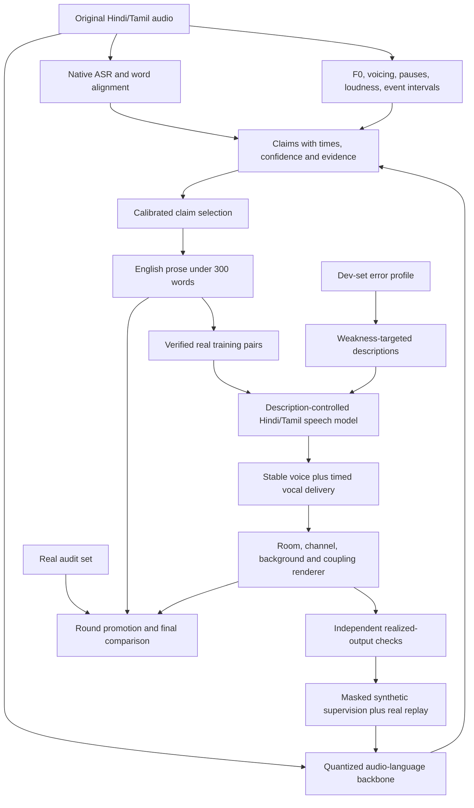

# Track 2 architecture after the literature first pass

**Hardware correction:** this historical draft assumed T4 GPUs. The user has clarified **4×L4 GPUs with 24 GB VRAM each**. Use [architecture v4](ARCHITECTURE_V4.md) and the [current experiment plan](EXPERIMENTS.md) for corrected hardware, precision and memory guidance.

**Historical version:** [version 3](ARCHITECTURE_V3.md) supersedes this recommendation and its budget after ten additional detailed main-text readings. Retain this document for first-pass evidence and model-card checks.

This updates the initial [architecture proposal](TRACK2_ARCHITECTURE.md). It is a research recommendation, not a trained or benchmark-winning system. Evidence comes from the review corpus and the [scoped core-paper notes](reviews/CORE_FINDINGS.md). Broad paper reviews inspect abstracts and selected full-text excerpts; they are not 200 cover-to-cover readings. Source acquisition, review depth, and reproduced experiments are separate statuses.

## The architecture to build

Use **two adapted specialists with a shared, evidence-bearing timed representation**:

1. A 7B-class audio-language captioner, supplemented by native-language transcript context and measured acoustic/event evidence.
2. A native Hindi/Tamil speech backbone with learned description controls, a stable identity prior, a shared event clock, and an explicit acoustic-scene renderer.
3. One complete, independently verified curriculum round connecting them, with real-data replay and per-claim supervision masks.

Do not train a new unified foundation model. UALM's reported pretraining uses 128 A100-80GB GPUs and about 80K generation-data hours; that recipe is not compatible with this project's 1,000 T4 GPU-hour budget. Its rich-caption planning and modality-alignment lessons remain useful [UALM, pp. 3–7](https://arxiv.org/abs/2510.12000).



## Backbone choices and decision gates

| Module | First candidate | Mandatory check before committing |
|---|---|---|
| Caption backbone | Audio Flamingo 3 7B, quantized frozen weights with LoRA/projector adaptation | Hindi/Tamil acoustic grounding, 30-second peak memory, adapter-loader compatibility |
| Caption alternative | Qwen2-Audio 7B | Same clips, prompts, precision, memory/cost and false-claim evaluation |
| First generation baseline | Indic Parler-TTS, comparing its pretrained and studio-finetuned checkpoints | Native pronunciation, eligible access, actual sample rate, description adherence, diversity and T4 throughput |
| Generation alternative | IndicF5 with description adapters and an internal voice prior | Added conditioning must beat the description-native baseline without losing text fidelity |
| Native text evidence | Eligible Hindi/Tamil ASR and alignment; official IndicConformer for final CER when specified | Native-script conventions, noisy-speech failures, no fabricated words during silence |
| Ecology | Lightweight event detector and deterministic effects; optional eligible text-to-audio branch | Audible realization, precise timing, no identity drift or speech masking |
| Training verifier | Measurements plus a separately frozen semantic verifier and sampled native audits | Independence from the learning captioner; actual calibration on both languages |

Subsequent retrieval through Hugging Face's `resolve` endpoint and public model API succeeded for the model cards and Indic Parler metadata. The Indic Parler model card explicitly lists Hindi/Tamil, transcript-plus-caption inputs, 69 named voices, and Apache-2.0. API metadata reports 937,803,241 parameters and revision `660bc53c64ae83150613264111708a0465211237`. However, access is automatically gated (`gated: auto`), and unauthenticated config retrieval returned 401. Access acceptance/authentication is a prerequisite to running that checkpoint, not a blocker to reading its public paper/card. No credentials were requested or added during this research task.

The [RASMALAI paper](https://arxiv.org/abs/2505.18609) directly supports using IndicParlerTTS as the first baseline, rather than first building description conditioning into IndicF5. It reports a broad 13K-hour pretraining set and a studio finetuning stage. Its high binned C50 accuracy also qualifies the earlier generic-Parler evidence of weak room control: different models, labels and test distributions can yield different results, so learned vs explicit room control must be compared locally.

The current model card recommends the newer Indic-Speak for general TTS. Its public metadata describes a 3.3B-parameter gated model with a custom license. That recommendation does not establish superior description following, so do not switch to it without an eligible-license/interface check and the same Track 2 tests. IndicF5's official documentation separately supports Hindi/Tamil and a 24 kHz output example. None of these model claims was reproduced here.

Qwen3-TTS's published language list excludes Hindi/Tamil; it is not the default final generator simply because the PS suggests it. A 30B MoE captioner may be an optional teacher, but 3B active parameters do not imply a 3B memory footprint. Avoid spending the project on making the optional teacher fit.

AF3's Whisper-derived unified encoder and staged adaptation are useful precedents, but the authors' full training cost is also large. We are adapting a released model, not reproducing AF3 pretraining [AF3, pp. 3, 7](https://arxiv.org/abs/2507.08128).

## Captioning: optimize supported information

Maintain separate evidence for sound, ecology, and intent. Frame-level measurements and a temporal head provide localization; ASR supplies lexical context; the audio-language model interprets their combination. Keep the original audio available, because denoising/restoration can erase the room, channel, breath and event evidence being graded.

An internal claim contains:

```text
claim text / axis / item type / global or interval
source-time interval / evidence references / origin
calibrated confidence / validity mask / uncertainty flags
```

This is not a fixed public tag vocabulary. The output remains English prose, and unfamiliar events retain free-text descriptions. Reserve output space for local changes and intent instead of letting generic speaker descriptions consume 300 words.

Use roughly a 280-word target with a final conservative word count. Include numerical estimates only when supported by reliable measurements. Never infer a precise age, geography, microphone distance, room material, or social relationship merely because the model can write a plausible sentence.

Timestamp tokens, synthetic mixtures, and temporal weighting are precedents, particularly TAC; they are baseline building blocks rather than novelty. TAC also motivates labeling **realized activity**, not an asset's nominal placement, because silence, masking and reverberation tails alter the audible interval [TAC, pp. 3–5](https://arxiv.org/abs/2602.15766).

Train claim selection on native-checked correct and false claims. Calibrate by language/type when data permits, with pooled regularization for small subgroups. Assess both useful coverage and false claims: refusing to describe everything is not success. Temperature scaling is a starting method for suitable classifier scores, not an automatic calibration guarantee for arbitrary natural-language probabilities [calibration](https://arxiv.org/abs/1706.04599).

## Generation: separate identity, delivery, and ecology

First exploit the description encoder already provided by Indic Parler-TTS, keeping transcript and description tokenizers separate as the model card requires. Compare its pretrained/fine-tuned checkpoints before adapting it. The card explicitly lists Tamil in its tested emotion-prompt languages; Hindi emotion support is less extensively tested. Native Hindi expression tests are therefore essential. Test full 300-word descriptions for token truncation, not just the output caption word limit.

For the IndicF5 branch, use an English description encoder and gated cross-attention adapters in the pretrained speech model, with linguistic text in its own input path. Adapter placement differs between the Parler codec decoder and the F5 DiT; they are alternative implementations, not interchangeable code. Add frame-aligned delivery controls only after global description conditioning works. F5's original model has no guaranteed fine-grained paralinguistic control, and its total-duration estimation does not guarantee event timing [F5-TTS, pp. 4, 9](https://arxiv.org/abs/2410.06885).

For a reference-conditioned model, choose internal licensed training references from the requested voice region. Never require the evaluator to provide a reference recording. Sample one identity per output clip; maintain it across all phrases and vocal events. Generate ten seeded outputs with compatible but varied identities. A finite reference bank is a useful first implementation, with measurable diversity limits. A learned conditional identity prior is a later experiment if the bank demonstrably limits the score.

Separate local delivery from stable identity. PromptTTS++ provides an important precedent and a caution: mechanisms that produce average voices may rate naturally while lacking diverse samples [PromptTTS++](https://arxiv.org/abs/2309.08140).

Use a single clock for speech, laughter/breath, background sounds, and responses. Render known room responses, channel filters and simple effects explicitly rather than asking the TTS backbone to learn every ecology property at once. Description-conditioned synthesis has reported weak C50 control even when other properties respond well [synthetic-annotation TTS, p. 4](https://arxiv.org/abs/2402.01912).

The diversity gate is important for Indic Parler: its named native pool contains only four Hindi voices and two Tamil voices in the current card. Ten seeds do not create ten identities. Compare compatible cross-lingual named voices, unnamed description-conditioned sampling, and the broader pretrained model, measuring native accent and relevance as well as diversity. If the pool remains the bottleneck, adapt a conditional voice prior using licensed multi-speaker data. Do not promise ten distinct passing speakers from two native voices.

Learn phonation and interaction changes from real examples. Gain is not vocal effort; pitch shifting is not falsetto; adding a whistle to static speech is not the Lombard effect. Background mixing alone does not satisfy “Coupling.” VoiceLDM already studies content plus environmental conditioning, and WavJourney studies compositional audio planning; cite both when presenting a modular renderer [VoiceLDM](https://arxiv.org/abs/2309.13664), [WavJourney](https://arxiv.org/abs/2307.14335).

The modular design has a real limitation: arbitrary fantastical descriptions can require generative backgrounds and interactions it cannot express. Measure this coverage explicitly. Optional pretrained text-to-audio support must fit eligibility and compute constraints. Do not silently exclude these descriptions from evaluation.

## The loop and the proposed research question

**Research question:** Does a per-claim verified, weakness-targeted synthetic curriculum improve real Hindi/Tamil description quality more efficiently than random verified synthesis, extra real-data replay, or reciprocal model agreement?

This is an experimental question, not an established novelty claim. CycleSpeech already connects speech generation and understanding through structured profiles and reciprocal optimization. It must be discussed as close prior work. Its substantial full-system gains include supervised adaptation; the incremental reciprocal-stage understanding gains are smaller, and some language/content tradeoffs remain [CycleSpeech, Tables 3, 4, 8](https://arxiv.org/abs/2609.24771).

[TAC2](https://arxiv.org/abs/2610.36568) is another particularly close precedent: it fuses teachers on a common timeline, elicits speech-attribute specialists, distills structured descriptions, and uses them for controllable audio generation. [Frame-level grounding](https://arxiv.org/abs/2609.15215) already supplies a separate temporal-evidence path, and [ATTEST](https://arxiv.org/abs/2610.17149) proposes counterfactual and attention-grounded temporal rewards. Neither a shared scene representation, teacher fusion, temporal tools, nor counterfactual supervision alone is a defensible novelty claim. Treat released eligible versions as additional comparison candidates if obtainable; do not assume a paper implies a runnable checkpoint or that a LoRA-based teacher is small enough for one T4.

Run one complete round:

1. Freeze C0/G0, their wrappers, prompts, revisions and all baseline results.
2. C0 describes a balanced real training pool. Measurements and sampled native checks qualify individual claims.
3. G1 learns from reliable `(text, description, audio)` pairs. Keep raw and restored audio purposes distinct.
4. Identify C0's real-development weaknesses by language, type and interaction. Generate feasible targets, retaining a random/easy quota.
5. Check what G1 actually produced. Relabel realized timing/parameters and mask unverified properties. A scheduled laugh that is absent is not a positive laughter example.
6. Train C1 using verified synthetic examples and substantial real replay. Track the real/synthetic mix as an ablation, not an unquestioned constant.
7. Promote only after matched-budget comparisons on real data, then a predeclared real audit. Stop the loop if useful coverage or a language regresses.

Use per-condition priority based on calibrated real error, estimated importance, generator success and cost, with caps and language balancing. A generator's unsupported region should not consume the whole synthetic budget. Prior active-learning and uncertainty-filtering work already motivates targeted acquisition; do not label this formula itself novel without a broader novelty check.

Do not begin with joint GRPO/RL or end-to-end gradients through a self-judge. These multiply rollout cost and can reward shared mistakes. Add reciprocal optimization only if the simpler loop leaves a documented gap that survives independent evaluation. Model-collapse research motivates retaining real support, but does not prove every mixed synthetic-data recipe must collapse [recursion study](https://arxiv.org/abs/2305.17493).

## T4 implementation and budget

Keep the [1,000 GPU-hour ceiling](EXPERIMENTS.md). Use FP16 with gradient scaling, tested Turing-compatible attention, quantized frozen LLM weights, activation checkpointing, microbatch 1 initially, and cached frozen features where valid. Four T4s are separate memory devices. DDP only works if each replica fits; use independent annotation/evaluation jobs where that is more efficient.

Require a pilot on 5-, 15-, and 30-second clips before setting data scale or training steps. Check actual memory, wall-clock throughput, loader support, and numerical stability. Training and inference numbers reported for A100/3090 hardware are not T4 measurements.

The budget remains: 50 pilot/baseline, 100 labels/optional teacher, 130 caption adaptation, 220 generator, 140 targeted synthesis/C1, 160 ablations, 100 final evaluation, 100 reserve GPU-hours. Reallocate based on measured bottlenecks; preserve the ablation/evaluation reserve.

## The three decisive experiments

1. **Evidence grounding:** same caption backbone with/without the measured-evidence path, comparing supported coverage, false claims and timing on real Hindi/Tamil audio.
2. **Curriculum value:** matched-compute extra real replay vs random verified synthesis vs weakness-targeted verified synthesis.
3. **Verification value:** identical target requests and synthesis budget, with per-claim independent verification/masking vs unverified requested labels.

Also compare global-only vs timed generator controls, fixed vs sampled identity, and learned-only vs explicit room controls as budget permits. Distinguish diagnostics from causal training ablations.

For final decisions, keep separate native CER, instruction relevance, naturalness, between-output speaker diversity, and within-clip consistency. Speaker-verification mismatch studies warn that changes in vocal effort/overlap can move embeddings without creating a new speaker [vocal effort](https://arxiv.org/abs/2008.02487), [overlap](https://arxiv.org/abs/2304.03515). Test these confounds locally while keeping the organizers' fixed evaluator unchanged.

## What would change this recommendation

- A verified Hindi/Tamil description-native checkpoint that beats the adapted IndicF5 path at lower cost should replace it.
- If audio-language quantization harms local grounding, use a smaller supported model or projector-only adaptation rather than shrinking away timing evidence.
- If targeted examples fail realization, spend on generator/data quality before training more C1 rounds.
- If native tests show that learned room/event controls outperform modular rendering without hurting content or identity, simplify the renderer.
- If controlled comparisons show no benefit from the proposed mechanism, report it honestly and retain the stronger baseline.

The defensible objective is the strongest **measured** system within the budget. No literature review alone establishes a “best possible” architecture.
