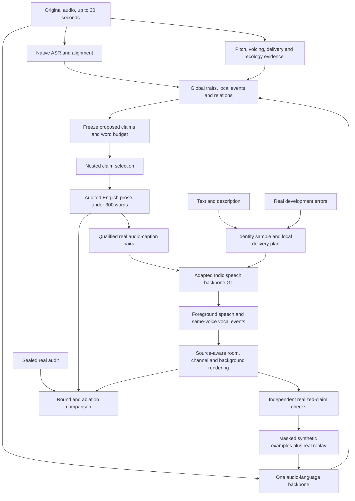

# Track 2 architecture, version 3

This is the revised research recommendation for **4×T4, 256 GB RAM and 1,000 GPU-hours**, informed by [ten additional detailed main-text readings](reviews/round2/DETAILED_REVIEWS.md). It supersedes [version 2](ARCHITECTURE_V2.md). It has not been trained, profiled on T4s or shown to win the benchmark. The new reading changes the identity sampler, delivery evidence, claim selection, scene rendering and loop evaluation; it does not justify building a larger foundation model.

## Recommendation

Build two adapted specialists around a hierarchical, time-indexed evidence representation:

- **Captioner:** one released audio-language model, native ASR/alignment, cached delivery/acoustic evidence, and a claim selector that trades supported coverage against false assertions.
- **Generator:** a pretrained Hindi/Tamil description-conditioned speech backbone, separate stable identity and local delivery controls, and a source-aware scene renderer. Test a small conditional identity prior in the first round because the native named-speaker pool may cap diversity.
- **Learning loop:** C0 captions real training speech to train G1; independently checked G1 outputs target C0 weaknesses to train C1. Compare both directions with matched controls on real, speaker-disjoint native data.

The representation is internal. Public descriptions remain free English prose with open-ended values, unfamiliar sounds and compositional instructions. A typed record is an organizational aid, not a public closed label set.

## What changed from version 2

| Previous choice | Revised choice | Evidence and consequence |
|---|---|---|
| Try a learned identity prior later if a bank fails | Budget an early interface test and small conditional-prior experiment within G1 | PromptTTS 2 distinguishes sampled variation from decoder noise. Native Indic Parler names alone cannot supply ten different native identities. |
| Generic acoustic evidence alongside the main captioner | Separate identity diagnostics from a small windowed delivery expert, with explicit validity masks | StyleCap's speaker x-vectors lose delivery information; PENN's ablation exposes voicing failures hidden by pitch error. |
| Calibrate a confidence filter | Freeze proposals and budget, enforce nested removal, define a bounded proxy loss | CRC requires a suitable loss and exchangeability; arbitrary confidence or variable-denominator precision does not satisfy it. |
| Explicit room/background renderer | Specify source-specific paths and dry/wet ownership; independently score events | Brouhaha's simulation clarifies source paths; CapSpeech shows good WER can coexist with weak event quality. |
| Real replay and targeted verified synthesis | Audit acceptance bias and identity/style coverage, and prove both loop directions independently | MAD motivates monitoring mixture and filtering effects; it does not establish failure of this one-round captioner loop. |

All numerical evidence and reading limitations are in the linked reviews. These are adaptations of prior ideas, not claims that identity priors, factorization, temporal grounding or synthetic verification are new.

## 1. Backbones and feasibility gates

Use the same initial shortlist as version 2. Compare Audio Flamingo 3 7B and Qwen2-Audio 7B on identical native clips, then retain **one** caption backbone. Adapt frozen quantized weights with a supported LoRA/projector path. Add a small frozen-feature delivery head only if its native validation gain justifies cost. Do not run multiple 7B experts per clip by default.

For generation, compare eligible Indic Parler-TTS pretrained and studio-finetuned checkpoints before adaptation. Its public card supports Hindi/Tamil and description-plus-transcript inputs. Metadata checked in the previous pass reports approximately 938M parameters, Apache-2.0 in the card, and automatic access gating; actual weights/config retrieval requires eligible authenticated access. No checkpoint was executed in this review. Hindi expressive control needs native tests; Tamil is explicitly among the card's tested emotion-prompt languages. Preserve an IndicF5 description-adapter branch only if the first baseline fails a documented gate or the alternate conditioning interface proves better.

The card lists four Hindi named voices and two Tamil named voices. Test compatible unnamed sampling and cross-lingual named voices for native pronunciation and relevance. Do not count ten random seeds as ten identities. Qwen3-TTS has no Hindi/Tamil in its published supported-language list and remains outside the default path. General-TTS recommendations for gated/custom-license Indic-Speak do not establish description following or eligibility.

The first 50 GPU-hours buy measured loader, precision and throughput tests at 5/15/30 seconds. Record peak allocated/reserved memory, wall time, batch size, OOMs, generation duration and numerical failures. Use FP16 with gradient scaling and supported Turing attention; do not require native BF16 or assume FlashAttention-2 support. Four T4s have separate memories: DDP requires each replica to fit. Initial scheduling can run independent labeling/evaluation jobs rather than force model parallelism.

## 2. Hierarchical representation and data ownership

Each example has four linked levels:

| Level | Stored information | Supervision rule |
|---|---|---|
| Clip/global | Perceived voice traits, stable identity latent for generation, overall channel/room summary | Do not convert perceived age/accent into known biography; do not copy global style onto every interval. |
| Interval | Word-aligned delivery, voice quality, vocal/non-vocal events, local acoustic changes | Carry source time, valid support and temporal uncertainty; unknown is distinct from absent. |
| Relation | Event order, interruption, response, voice-background coupling, supported intent | Require relevant acoustic/context evidence. Emotion alone does not establish intent or a social relationship. |
| Claim | Free-text proposition, axis, evidence IDs, uncertainty, origin and verification state | The unit of correctness, calibration and synthetic supervision; a requested claim is not a realized fact. |

Maintain original real audio, transcript/alignment, restoration-derived views and synthetic stems separately. Never replace the original with denoised audio for ecology captioning. Each specialist gets its own resampled view. Store asset/model revisions, license/provenance, speaker/session groups, renderer parameters and a seed manifest. A generated scene graph is a plan; only verified rendered properties become positive training labels.

For measurements, save `analysis_window`, `hop`, `valid_interval`, `voicing_or_quality_mask`, `estimate`, `uncertainty`, `method_revision` and `source_view`. Frame hop is not independent time resolution. Brouhaha's two-second SNR labels do not support asserting a 16 ms noise-level change simply because output frames occur every 16 ms.

## 3. Captioner: grounded proposals before fluent prose

**Evidence path.** Native ASR provides lexical context and word timing; the audio-language model still sees original audio. Pitch/periodicity, voiced rate, pauses, loudness, event activity and coarse room/noise estimates are separate evidence. Add a cached WavLM layer-mixture representation with global and windowed pooling as a small delivery expert, inspired by StyleCap. Speaker-verification embeddings are for identity consistency/diversity diagnostics, not the sole representation of prosody.

PENN is a candidate pitch/periodicity source, not automatic truth. Mask unreliable voicing, overlaps, out-of-range values and suspected octave errors. Use voiced-frame robust log-F0 summaries and local relative contours. Whispering need not have a meaningful pitch estimate. Normalize comparisons carefully across language, speaker and recording conditions. Raw F0 variance is not a sufficient definition of expressiveness. Brouhaha-style estimates can support coarse ecology, but do not identify exact microphone distance or room materials.

**Proposal path.** The adapted main backbone proposes a bounded set of evidence-linked atomic claims with open text values. Train using native-checked claims and hard negatives; distinguish unsupported from contradictory claims. A local delivery change should not become a global speaker trait. Intent proposals need lexical/prosodic evidence and must survive native review. Avoid filling an axis with an unsupported claim merely to cover the rubric.

Before calibration, freeze the proposer, candidate ranking, maximum count M, token-to-word policy and a conservative **280-word proposal budget** including timestamp text. The fixed budget may reserve slots for local events and intent, but unused slots need not be filled. Final output must be below 300 words under the agreed conservative counter. The PS's own cutoff remains authoritative.

**Selection path.** Score claims using evidence features and supervised native judgments, with type/language indicators and domain flags. ParaCLAP-like similarity is a feature, not a correctness probability or universal intent verifier. Thresholding only removes from the fixed proposal set. It must not trigger refill or an unconstrained rewrite that creates new claims. The renderer uses audited sentence templates with free-text values and explicit times, preserving scope, negation and intensity. This still yields prose; it does not expose a label list. Audit both candidate values and rendered sentences for extra assertions.

**Calibration, with a precise boundary.** Let `Sλ(x)={c in P(x): score(c)>λ}` for frozen, budgeted proposals P with at most M claims. Define

`L(x,λ) = number of false or conservatively unresolved claims in Sλ(x) / M`.

With fixed M, this is bounded by one, non-increasing and right-continuous as λ increases; the empty-set extreme has zero loss. For n exchangeable calibration examples and target α, use CRC's corrected condition

`n/(n+1) * mean_i L(x_i,λ) + 1/(n+1) <= α`.

Use the theorem's threshold rule and safe extreme, with a deterministic score/threshold convention. This controls **marginal expected proxy risk** under its assumptions. It is neither a per-clip guarantee nor the official weighted caption score. False retained / retained count is a different, generally non-monotone loss. Do not substitute it into this formula. An empty caption can meet the proxy while failing useful coverage, so report the risk/coverage frontier and native usefulness alongside it.

Tune architecture and α on development data; freeze before separate calibration, then use a sealed audit. Repeated clips from a speaker/session need explicit treatment: use one randomly preselected clip per independent group for the clip-risk claim, or define a group-level loss and state that different target. Per-language thresholds require adequate independent units; tiny strata do not create meaningful guarantees. If exchangeability, labeling or monotonicity cannot be defended, keep empirical risk/coverage results and omit the guarantee. CRC's shift extensions do not automatically protect unknown competition domains.

Timing is evaluated twice: useful diagnostic interval accuracy, and the **actual PS interval-matching rule**, which widens rubric intervals by ±250 ms. A diagnostic boundary MAE is not a replacement for the official rule. Broad vague timing should not earn unsupported localization credit in our audit.

## 4. Generator: independent identity and delivery, with an explicit interface

Given linguistic text t and description d, compile a plan containing global voice constraints, interval delivery, event timing, scene properties and relations. Preserve the supplied linguistic text. Auxiliary event/control tokens belong to an internal control channel; the generator must not speak them or silently paraphrase the input. Test long descriptions for tokenizer truncation and clause loss.

Represent generation as `G(t,d,z_id,z_delivery,scene_plan)`. Draw `z_id` once per clip and share it across phrases and speaker-owned vocalizations. Draw local delivery variation separately, constrained by d. Both can retain unspecified variation without changing requested attributes. A lower speaker-similarity score alone is not evidence that identity changed appropriately.

**Conditional identity-prior experiment.** First determine which trainable conditioning interface the released model actually exposes. For a Parler branch, a possible modification is learned conditioning-prefix projections into the decoder's conditioning sequence, jointly trained with small decoder adapters and teacher-forced codec loss. Those vectors are not supplied by the public API today, and an untrained speaker-vector projection is not valid conditioning. For a reference-conditioned F5 branch, an internal licensed reference/latent can provide identity without asking for an evaluation reference. Either branch needs a paired training loss that makes its chosen identity representation usable by the backbone.

Start with a small conditional mixture prior over an eligible multispeaker training representation, conditioned on broad requested voice constraints. Compare a bank, named controls and mixture sampling before considering diffusion/flow priors. Fit samples to a supported latent distribution and learn the projection jointly; arbitrary vector interpolation can leave the valid manifold. Freeze the large backbone initially and adapt the minimal useful path. PromptTTS 2 motivates stochastic variation, and ControlSpeech motivates avoiding reference-style leakage; neither proves this transplant will work. Reserve **100 GPU-hours** for the interface/prior experiment and stop it if it damages native CER, relevance or identity consistency.

Use swap tests to diagnose separation: hold identity/text fixed and vary delivery, then hold delivery/text fixed and vary identity. Compare similarity under normal, shouted, whispered and channel-modified speech to expose speaker-embedding confounds. Style diversity and speaker diversity are different axes. Report ten-output passing count, estimated distinct passing identities and within-clip consistency. Retain the organizers' fixed evaluator when available; these are supplementary diagnostics. The PS's one-voice/formula ambiguity still requires care, not an invented resolution.

**Local delivery and vocal events.** Start with reliable global description control; add interval conditioning only after it works. Align local controls to word/codec time and use duration supervision from real data. A shared clock handles speech, pauses, breath, laughter and backgrounds, but audible output boundaries must be remeasured after synthesis. Same-speaker laughing/crying cannot be implemented by pasting an unrelated actor's sound onto the clip. If no compatible vocal-event support exists, document that coverage gap and train from eligible same-speaker examples or simplify the supported cases.

**Coupling.** A background affects delivery upstream: noise may change effort; interruptions may change pauses; physical exertion may alter breath and rhythm. Gain is not effort, and pitch shifting is not falsetto. Independent background mixing is only one part of the requested scene. Use real or verified joint examples to learn these relations. Keep unsupported fantastical/compositional requests in evaluation with explicit failures; do not quietly shrink the benchmark to available effects.

## 5. Source-aware rendering and independent checks

Use an explicit composition contract, schematically

`y = channel(h_s * speech + sum_j h_j * background_j + mic_noise)`.

Each source has placement, gain and an acoustic path. A shared room can still have different source positions. Mark each stem as dry, already reverberant, already noisy or unknown. Do not apply the room effect twice or assume an outdoor recording asset is a clean source. A speech backbone that already renders the requested channel/room uses an appropriate pass-through or limited residual path. Compare learned-only, explicit and hybrid ecology locally.

Known synthesis parameters give plan labels, not guaranteed audibility. Verify after mixing/resampling/limiting, because masking, silence, reverberation tails and clipping change realized claims. Confirm final sample rate is at least 24 kHz; upsampling is not evidence of new bandwidth or good quality.

Keep separate checks for native text CER, description relevance, naturalness, event identity/audibility, event timing, ecology, coupling and speaker consistency. CapSpeech's low-WER/weak-event result rules out using CER as a sound-event pass criterion. For simulated effects use known parameters plus separately chosen estimators/listening audits. A model used to label examples must not be the only judge of their correctness. A second model can share errors too; native sampled audits remain necessary during training/evaluation, while final inference stays automatic and uses eligible open models.

## 6. A falsifiable reciprocal round

Use speaker/session-disjoint **training**, **development**, **calibration** and **sealed audit** partitions, balanced by Hindi/Tamil and difficult conditions. Keep organizer/contributed evaluation items outside all train/tune pools. Predeclare audit protocol and comparisons before inspecting results.

1. Freeze C0/G0, prompts, wrappers, revisions and pilot results. Record failures as well as successful outputs.
2. Caption a balanced real training pool with C0. Qualify individual claims; do not turn missing descriptions into negative acoustic labels. Preserve uncertainty and original recordings.
3. Train G1 on these real audio-caption-text pairs, using reliable loss masks. Compare it against equal-compute G0 adaptation on the same real audio with simpler measured/global captions. This isolates whether C0's richer descriptions improve generation rather than merely adding training.
4. Estimate C0 weaknesses on development clips by language, claim type and interaction. Target only generator-feasible regions while keeping random/easy quotas and diversity caps. Unsupported regions become generator/data work rather than endlessly rejected synthesis.
5. Generate both matched G0 and G1 outputs for a fixed request list, with equal verification and inference budgets. Independently relabel realized claims and times. Mask uncertain/absent properties instead of training from the request as ground truth.
6. Train C1 with verified targeted examples plus real replay. Compare against equal-compute extra real replay and random verified synthesis; include a small G0-versus-G1 source control. Match update count and report accepted sample counts, acceptance rates and all acquisition costs.
7. Audit the chosen configuration once on sealed real data and report both directions. Do not count improved synthetic agreement as improved real captioning. Additional rounds require measured gains and remaining compute; one complete, well-controlled round is the priority.

MAD is a reason to inspect recursion and acceptance bias, not proof that this recipe must collapse. Track the distributions of speakers, phonation, language, room/noise, intent and interactions before and after verification. A filter can improve average quality while erasing hard or rare cases. Cap repeated identities/prompts, keep independent fresh real training support when available, and sweep synthetic share rather than asserting a universal safe ratio. Never use fresh audit data as replay.

## 7. Budget and decisive comparisons

The following **replaces** version 2's allocation; it is a total ceiling, not extra compute. A GPU-hour is one GPU occupied for one hour, including failed jobs and verification. Four T4s running continuously for 250 hours use the entire budget; actual scheduling may be longer.

| Work package | GPU-hours | Required output |
|---|---:|---|
| Native baselines and T4 feasibility | 50 | Loader/access gate, memory/throughput, C0/G0 errors |
| Evidence cache and labeling | 80 | Native claim checks, measured features and provenance |
| Caption adaptation | 120 | Frozen C0, evidence-path comparison, claim selection |
| Generator description/delivery adaptation | 200 | G1 and equal-compute caption-quality control |
| Identity interface and small prior | 100 | Bank/seeds/prior comparison or documented failure |
| Targeted synthesis and C1 | 120 | One complete verified reciprocal round |
| Controlled ablations | 150 | Matched-budget causal comparisons below |
| Final native audit and outputs | 80 | Real held-out results and PS-format samples |
| Failure/variance reserve | 100 | OOM/restarts, uncertain comparisons, final stability |
| **Total** | **1,000** | No large-model pretraining |

Cache frozen features and codec targets where compatible; invalidate caches when their producing model changes. Use the 256 GB RAM for data/feature staging, not as assumed GPU VRAM. Begin with microbatch one and activation checkpointing; choose steps/data hours only after measured throughput. Published H100/A100/3090 timings cannot price T4 jobs. Keep the reserve and prune optional modules that fail their gates.

| Comparison | Keep fixed | Decision metric |
|---|---|---|
| Main captioner vs +delivery/evidence path | Backbone, real examples, updates, prompt | Correct claim coverage, false assertions, local timing, cost |
| Empirical filter vs nested calibrated selector | Frozen proposals, native split, word budget | Proxy risk/coverage, actual native rubric audit; state assumptions |
| Named/bank/seeds vs conditional prior | Text/description requests and synthesis count | Distinct **passing** identities, native CER, relevance, within-clip identity |
| Global vs interval delivery controls | Speech backbone, training support | Realized transitions/events and text preservation |
| G0 vs G1 captions/outputs | Real audio or synthesis requests, compute | Separate gains from C→G and G→C |
| Real replay vs random vs targeted verified synthesis | Total GPU cost and C updates | Real audit improvement per GPU-hour, each language |
| Requested labels vs independently realized labels | Targets, samples and training updates | False-claim reduction without coverage collapse |
| Learned vs explicit/hybrid ecology | Same text, voice and requested scenes | Audible ecology, naturalness, coupling, CER |

Allocate ablations sequentially: core evidence/loop/verification comparisons first; small delivery and ecology tests next. A full factorial design is unaffordable. Treat the initial identity comparison as a pilot within its own 100-hour package, not an additional large run charged twice.

## 8. Research claim and stopping rules

The strongest defensible question is: **Can independently verified, time-local and diversity-preserving synthetic teaching improve real Hindi/Tamil caption coverage at a controlled false-assertion cost within a fixed T4 budget, while richer real captions improve generation?**

Close prior work already includes CycleSpeech's reciprocal profiles, TAC/TAC2's temporal teacher fusion and generation supervision, ATTEST's counterfactual grounding, PromptTTS 2's variation prior, ControlSpeech's separated controls, StyleCap's delivery captioning and CapSpeech's event-aware TTS. Version 2 links the first group; the round-two notes link the new group. Neither the loop nor their combination alone establishes novelty. Report the exact contribution, native-language evidence, failures and marginal gains; perform a further novelty check before calling the method new.

Stop or simplify a component if it fails real native validation, cannot fit the hardware, cannot access eligible weights, or consumes its allocated budget without a useful gain. Promote a new round only when it improves supported coverage without an unacceptable false-claim, language, naturalness or diversity regression under predeclared criteria. Retain the strongest measured baseline when an extra mechanism fails.

The result of this review is a concrete architecture and falsifiable plan. The PS requires automatic open-model outputs at runtime, no evaluation reference, English captions under 300 words, generation at ≥24 kHz, all three description axes and an actual round beyond C0/G0. Nothing in the reviewed papers substitutes for demonstrating those requirements with the submitted system.
