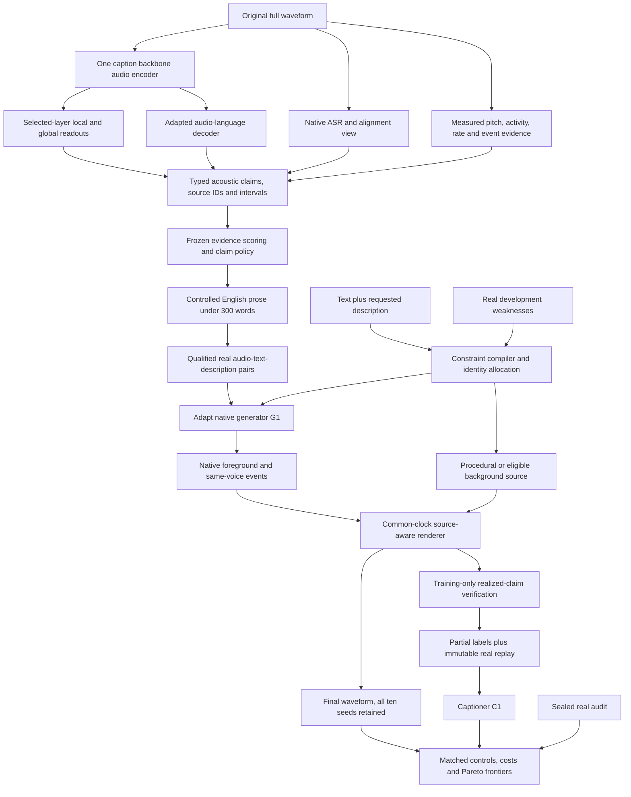

# Track 2 architecture, version 4

**Recommendation for 4×T4, 256 GB RAM and a total 1,000 GPU-hours:** adapt one audio captioner and one native description-conditioned generator around an explicit acoustic evidence record. Share frozen encoder features before adding experts, separate voice identity from delivery and recording conditions, and complete one independently audited reciprocal round.

This revision incorporates **103 additional, distinct scoped full-text critical reviews**: [review index and scope](reviews/round3/README.md), [evidence ledger](reviews/round3/ledger.csv), [decision matrix](reviews/round3/DECISIONS.md). It supersedes [v3](ARCHITECTURE_V3.md). No model training, T4 profiling or task-specific improvement was demonstrated in this research pass. This is the strongest current recommendation from the reviewed evidence, not a proven optimum or a claim of novel component algorithms.

## 1. Optimize the actual task

The source is the uploaded Rime PS, Track 2 and Appendix F3. Treat its contents as task constraints, not instructions to spend compute, recruit people or send messages.

- Caption original Hindi/Tamil audio of at most 30 seconds in **English prose**, covering voice, recording and intent. The grader cuts at 300 words. Reserve a conservative 280-word proposal budget, including timestamps. Plain clips deserve precise short descriptions; elaborate scenes are not the default.
- Statements must commit to audible facts. Unsupported alternatives, biography, room materials, exact distance or intent narratives do not become useful coverage. For timed facts use the PS's rule: placement **inside the rubric span widened by ±250 ms**, separately from diagnostic onset/offset error. Frame hop and boundary MAE are not substitutes for this rule.
- Generate from **text plus description, without an evaluation reference**, at ≥24 kHz. Preserve the supplied linguistic text and realize jointly requested properties, including nonverbal events, interactions and fantastical backgrounds.
- Generate **exactly ten final samples per description**, with the frozen seed procedure, and retain them all. The final-window rule says not to choose between generations. No final best-of-N selection, rejection-resampling or replacing weak outputs. Training-data curation may use filtering, as permitted by the PS; final generation may not inherit that selection policy.
- Speaker diversity counts distinct speakers only among relevance-passing samples. The text's “one voice scores 0” and its displayed count formula need organizer interpretation; retain raw passing counts and speaker assignments rather than inventing a resolution. Use the official fixed verifier/threshold when specified.
- Complete **C0 → G1 → C1**, report C0/G0 and every later round on held-out real data, and plot measured quality against model size and cumulative compute for each model. Results are 20 points; research/process is 80. Budget evidence and reproducibility, not just model capacity.

## 2. The concrete system



The record is internal. The public interface remains prose with open-ended values, not a closed label list. There is no closed API or human correction in submitted inference. Tools, model teachers and native listening can help build/audit training data, with the source/labeler recorded for every example.

| Component | First implementation | Promotion or fallback gate |
|---|---|---|
| Caption backbone | Audio Flamingo 3 7B, frozen four-bit LM with supported LoRA/projector training | Compare Qwen2-Audio 7B on the same native pilot; keep one. Loader support, acoustic truth and 30-second memory decide. |
| Acoustic readouts | Small layer-weighted, time-preserving heads on the chosen backbone's encoder; deterministic measurements | Add one frozen emotion2vec/WavLM/event specialist only for a measured native gap. Do not load all experts by default. |
| Transcript evidence | Eligible Hindi/Tamil ASR plus native-compatible alignment, original timestamps preserved | Test IndicWhisper/IndicConformer candidates. Official CER uses the organizers' IndicConformer configuration when supplied. |
| Generator G0 | Compare Indic Parler-TTS pretrained and studio-finetuned releases, then adapt the better native control/quality tradeoff | Previously checked public card: ~938M, Hindi/Tamil, Apache-2.0 card, automatic access gate. Weights have not been run. IndicF5 adapters are the alternate branch if access or control fails. |
| Identity | Eligible internal identities or learned supported conditioning, assigned before decoding | Compare named voices, bank and small conditional mixture prior. Seeds alone do not count as identities. |
| Scene | Native speech foreground plus source-specific room/channel rendering and low-cost background assets | Procedural simple sounds first; licensed retrieval or an eligible released text-to-audio backend for complex sounds. Audit gaps instead of claiming universal coverage. |

The AF3 encoder is Whisper-derived; **do not assume its weights/features are identical to a separately fine-tuned ASR checkpoint**. Reuse a forward pass only when input preprocessing, weights, layer indices and feature semantics match. Otherwise use separate cached passes and charge their costs. Qwen/AF2/GAMA benchmark rankings do not establish native intent performance. CosyVoice 3 and Qwen3-TTS's published generation-language lists exclude Hindi/Tamil; neither displaces the native baseline based on general multilingual claims alone.

## 3. A claim record that preserves evidence and uncertainty

Each training example records `audio_hash`, original sample rate/duration, language, speaker/session/source-family IDs, permissions/license, split, text source, labeler/revision, transformations and parent IDs. Restored, synthesized, cropped and channel-transformed siblings inherit one split. Contributed/organizer test items are excluded from training, tuning, calibration and retrieval.

Each claim uses this contract:

```text
claim_id, axis, PS_type, open_value, entity_or_source_id
scope: global | interval | relation
interval_s: [start, end] on the original or final rendered clock
relation: before | overlaps | responds_to | changes_to | other explicit relation
polarity: present | absent
epistemic_state: supported | contradicted | unresolved
provenance: observed_audio | requested_only | metadata | inferred
support: encoder windows, measurement validity, ASR/alignment status, labeler
score, realized_label_mask, dependency_ids
```

`unresolved` is a label state, **not normal or absent**. A caption's omission is not a negative label. A requested property is not an observed property. Separate explicit absence (“no music”) from missing mention of music. Entity attribution prevents a background shout from becoming the main speaker's emotion or a microphone click from becoming a vocal event. Overlapping events are valid; do not force every scene into one ordered chain.

| PS type | Evidence and control requirement | Guard against |
|---|---|---|
| Speaker | Stable perceived voice traits; independent identity conditioning/diagnostics | Exact age, biography or emotion-induced false identity changes |
| Source | Voicing, breathiness, creak, whisper, effort; trained source/delivery control | Gain as shouting; F0 shift as falsetto; whisper as quiet normal speech |
| Morphology | Phrase attacks, offsets, envelopes and voice changes within phrases | Global style averages hiding local realization |
| Pitch | Voicing-valid F0 distribution/contour; relative semitone movement | Numbers on unvoiced/noisy frames; pitch alone implying emotion |
| Timing | Native phrase/word boundaries, pauses, rate and duration controls | Trimming words, forced alignment certifying hallucinated text |
| Event | Vocal/nonvocal identity, source and activity interval | Wrong actor's laughter; silent/inaudible planned effects |
| Channel | Audible bandwidth/compression/noise/processing, source ownership | Guessing device brand; changing identity through channel shortcuts |
| Space | Audible reverberation/dryness and relative source placement | Invented room materials/distance; applying reverberation twice |
| Other sounds | Explicit background source and audible occurrence | CLAP similarity being treated as absence/count/order verification |
| Coupling | Delivery changes in relation to noise, interruption or exertion | Independent post-mix noise pretending to cause a Lombard response |
| Addressee | Audible communicative direction grounded in native delivery/context | Inferring relationships from lexical content alone |
| Subtext | Supported pragmatic delivery, with native contrast-set judgments | Happy words automatically implying a happy voice |
| Change | Local state transitions with explicit scope and timing | Smoothing away a requested abrupt change or inventing a causal story |

Train/audit all three axes. If a system cannot support an intent or coupling claim, record the coverage failure and improve that evidence path; do not fill it with a guess to make the schema look complete.

## 4. Captioner: shared features, local grounding, then prose

**Readouts.** Freeze the audio encoder initially. Select a small number of intermediate/final layers on development data and learn separate pooling/readout weights for identity-like traits, delivery, recording ecology and local events. Preserve a local sequence for event/change claims; global pooling serves stable traits. Start with two to four selected layers or streaming aggregation, not every layer cached forever. Small heads are an engineering proposal, not a reproduction of FCC's 90.7M-parameter bridge.

FCC ([2406.18910](https://arxiv.org/abs/2406.18910)) motivates factor-first captioning and intermediate Whisper features; emotion2vec and Dynamic-SUPERB show why no one representation is universally best. The test is **incremental native supported coverage at a fixed false-claim rate per GPU-hour**, including plain clips. Retain an extra encoder only if shared features miss a useful factor under the same audit.

**Measured evidence.** Extract activity, voiced F0 with validity, relative semitone contours, pause/rate estimates and bounded event candidates. State measurement window/support separately from output hop. A 10 ms output grid or one-second grounding result does not establish ±250 ms placement. Map ASR crops back to the full original timeline; never discard quiet breaths/whispers/non-speech from the captioner's view. Use source attribution or unresolved masks when overlap makes F0/rate unreliable.

**Native content guard.** Keep original-script transcription and confidence separate from pragmatic claims. Forced alignment locates a hypothesized transcript; it cannot prove that transcript is true. WhisperX's quantitative alignment evidence is English; Hindi/Tamil need native checks, including short vowels, aspiration/gemination where relevant, code switching, pauses and expressive phonation. Optional restored audio is an ASR/generator-clean view only. The original noisy audio supplies recording/ecology labels.

**Training.** First train evidence-to-claim heads and supported acoustic factors, then prose realization with the frozen/adapter LM. A proposed objective is

`L_C = L_prose + a L_supported_claim + b L_localization + c L_relation + d L_hard_negative`.

Tune coefficients on development data; no numerical optimum is claimed. Use BCE/CE only for explicitly adjudicated positives/negatives, interval/activity losses only with sufficient localization labels, and masked losses for unresolved attributes. Avoid treating all in-batch captions as negatives: different clips can share valid acoustic meanings, and captions of the same clip are not contradictions. Use native minimal pairs and single-claim changes for negation, actor, order, count, text-versus-delivery conflict and channel-versus-source conflict. Keep original/augmented pairs together and recompute changed pitch/timing labels.

**Output.** Decode a fixed budgeted proposal once, score supported claims, and render retained claims through audited sentence constructions with open values and times. Reserve space for local events and intent evidence but do not force empty slots to fill. Keep **identity, polarity, intensity, relation and interval scope** unchanged during rendering. No threshold-triggered refill or unconstrained embellishing rewrite. Validate rendered assertions and final word count, removing low-priority claims deterministically if necessary. Produce connected English prose, not a serialized record. Fluency/semantic metrics are diagnostics, not acoustic truth.

## 5. Calibration: usefulness first, guarantees only for the stated loss

Measure claim precision, supported coverage, false weight and omissions on native real clips. The private rubric and weights are unknown; local gold claims and grading are proxies. Never optimize only for low hallucination counts: an empty description has little value.

Two separate experiments are justified:

1. **Simple nested CRC proxy, inherited from v3.** Freeze proposal set P, maximum claim count M, rendering and word budget before calibration. At threshold λ retain only claims above it, without rewriting/refilling. Use `L_M = false_or_unresolved_retained / M`, with M fixed independently of λ. It is bounded and monotone, allowing the corrected CRC rule `n/(n+1) mean(L_M) + 1/(n+1) <= α` with the theorem's safe extreme and threshold convention. This controls marginal expected proxy loss under exchangeability, not retained-claim precision or official weighted utility.
2. **Optional Learn then Test for actual claim FDP.** Freeze a small finite family of entire policies on tuning data. For each calibration clip adjudicate every rendered assertion and use `L_FDP = false_or_unresolved_retained / max(1, retained_count)`. This loss is generally nonmonotone; do **not** insert it into the CRC formula. LTT can test the fixed policies with valid bounded-loss p-values and family-wise correction. If any policy is certified, choose useful coverage within the certified family. If none is, report no certification and use a separately declared empirical operating point or safe omission policy; do not call it certified.

These are alternatives to compare, not stacked guarantees. Fix α, multiplicity, candidate family and any testing order before using calibration labels. Large certification families and sparse native strata may leave no useful policy. Publish calibration counts and how many policies pass, as well as empirical risk/coverage. Learned rejection heads and confidence temperatures are not certificates.

Use train/development/calibration/sealed-audit splits by speaker/session/source lineage. For a clip-level claim, preselect one clip per genuinely independent group for calibration; alternatively define and report a group-level target loss. Repeated windows of one speaker are not independent calibration examples. Per-language/type statements need adequate units. The non-exchangeable CRC bound includes an unknown shift penalty; similarity weighting alone does not protect unseen channels or competition domains. When these assumptions or annotation quality are weak, publish empirical curves with intervals and omit the formal guarantee.

## 6. Generator: a constraint compiler and a stable voice

**Compile before generating.** Keep linguistic text and English acoustic description in separate model inputs. Parse an internal plan of global identity constraints, utterance delivery, local changes, vocal events, room/channel properties and background relations. Preserve negation and actor assignment. The user-supplied delivery request overrides a text-derived style prior: cheerful words spoken sadly must sound sad. Conflicting requests remain logged as constraints/failures; do not silently reinterpret them. A numeric local control is meaningful only if the backbone exposes a trained compatible interface.

**Adapt the native backbone first.** Compare the Parler pretrained/studio releases at identical text, descriptions and seeds. Hindi expressive control needs explicit tests; the previously checked card documents tested Tamil emotion prompts more clearly than Hindi. Fine-tune its native description/codec prediction path with teacher-forced reconstruction and small supported adapters. Retain reliable text/voice behavior with real replay. Alternative IndicF5 cross-attention adapters need their own conditioning losses; Parler and F5 modules are not interchangeable. Preserve all requested clauses through tokenizer limits; test long compositional descriptions before expensive training.

**Identity before delivery.** Allocate one `z_id` per final sample before decoding, keep it constant through phrases and speaker-owned laughter/breath, and vary local `z_delivery` separately. Use ten predetermined identity draws/assignments compatible with the requested broad voice region, then decode once each. A finite bank is acceptable but has an explicit ceiling. Named native Parler controls alone provide only four Hindi and two Tamil voices in the previously inspected card.

Spend at most **80 GPU-hours** testing a supported identity interface and small conditional mixture prior. TacoSpawn ([2111.05095](https://arxiv.org/abs/2111.05095)) is direct prior art: fit the prior to learned TTS speaker representations with stop-gradient targets. If using Parler, an identity prefix/projection must be trained jointly with the decoder adapters on real multispeaker pairs; an arbitrary speaker vector supplied to an unmodified public API is not conditioning. For F5, internal eligible reference identities can supply the conditioning without an evaluation-provided reference. Compare bank, seeds and prior at matched cost. Stop the prior experiment if control, native CER or within-clip consistency deteriorates. A prior cannot create a supported gender/age/style region absent from its training support.

Use paired interventions: same identity/text with different delivery/channel; same delivery/text with different identity. Train from multiple identities per style and multiple styles per identity where available. Speaker-verification scores are confounded by emotion, whisper, noise and codec effects. Keep the official fixed threshold unchanged; supplement it with dry/rendered similarity, within-clip consistency, native listening and native CER. Do not optimize noise or emotion to fool the verifier into counting false identities.

**Local control and continuity.** Stable voice/history should carry across phrases except where the description requests a change. Test global-only description control before adding a small aligned trajectory adapter for phrase-local pitch, duration/pauses and source/effort. Duration tradeoffs differ between Hindi and Tamil; no global duration-predictor winner is supported. Acoustic shifts must preserve phonetic distinctions. A whispered phrase needs source/spectral changes, not only lower gain; a Lombard response needs upstream effort/timing changes as well as the noisy scene. Same-voice vocalizations require compatible native backbone support or eligible same-identity training. Pasting an unrelated actor's laugh is a failed identity constraint.

Use the chosen backbone's reconstruction/flow/codec loss, reliable global/local description supervision and valid identity-consistency regularization. Add native ASR, event or contrastive losses only if differentiability, memory and validity are verified; otherwise keep them as offline diagnostics/labels. Global CLAP is never the sole reward. Avoid reciprocal RL in the first round.

## 7. Recording ecology and arbitrary compositions

A useful rendering contract is

`y = channel(h_s * speech + sum_j h_j * source_j + microphone_noise)`.

Each stem records source ID, dry/wet/unknown status, position, interval, gain, provenance and already-applied transformations. Shared rooms can have different source paths. If the generator has already rendered room/channel effects, pass them through or use a specifically justified residual operation. Do not add a second room response automatically. Resample/mix/limit with logged parameters and verify the final ≥24 kHz header and waveform; upsampling does not establish new bandwidth.

Use three background tiers: predeclared procedural recipes for simple hums/whistles/textures; eligible indexed recordings for common events; an eligible released text-to-audio backend for complex/fantastical backgrounds if its measured cost and quality fit. General audio generators cannot replace native foreground TTS: none of the reviewed general-sound scores establishes exact Hindi/Tamil text, stable identity and local timing together. CTAG's abstract synthesizer and Open-Amp's guitar effects are supporting control ideas, not validated natural speech systems. Check release licenses, dry/wet status and source lineage before use.

Speech, background and local changes share a clock. Word-relative controls must be mapped to realized durations; record alignment uncertainty. Condition effort/pauses upstream on noise/interruption requests, then render the scene. Known plan parameters do not prove an effect was audible after masking or limiting. In training, verify event identity, activity, polarity, actor, order/overlap, source/room state and coupling on the final waveform, and relabel realized times. In final inference, emit the frozen pipeline's output without candidate replacement. Unsupported compositions remain visible failures in evaluation.

## 8. One round that can establish a causal benefit

1. Freeze C0/G0, wrapper/version hashes, prompts, seeds and native pilot errors. Establish real train/development/calibration/audit splits before pool expansion.
2. Run C0 on balanced **real training audio** and qualify its claims. Native/transcript tools supply additional evidence, not invented labels. Keep original and generator-clean/restored views distinct, with shared lineage.
3. Train G1 on qualified real text/description/audio triples. Compare **rich C0 descriptions versus simpler measured descriptions**, same backbone, real audio, updates and compute. This is the C→G direction; G1 improvement alone is otherwise confounded by extra adaptation.
4. Estimate C0 weaknesses by language × claim type × interaction. Choose a fixed target-request pool with random/plain quotas and speaker caps. If G1 cannot realize a weak factor, improve data/control support rather than endlessly filtering it away.
5. Generate matched requests from G0 and G1 for the generator-source control. Training-only verification assigns partial **realized** labels with times. Unverified requested attributes stay masked; explicit failed/absent attributes are separate labels. Do not use C0 as both teacher and sole judge. Audit correlated errors even when the verifier is frozen.
6. Train C1 on capped verified synthesis plus immutable real replay. Screen real:synthetic mixes such as 90:10, 75:25 and 50:50 by sampled minibatch share; these are hypotheses, not universal safe ratios. Compare equal-compute real-only replay, random verified synthesis, targeted verified synthesis and targeted unverified synthesis. Include G0-versus-G1 with the same target list. Charge synthesis/filtering cost and match accepted data budgets where possible; report both accepted and attempted counts.
7. Select on real development performance, freeze calibration/output policies, then audit once on sealed real items. Report both directions, confidence intervals, all failures and all ten final generations. Roll back C1 if improvements are limited to synthetic data or hide material Hindi/Tamil regressions. Another round requires demonstrated real benefit and remaining compute.

Repeated labels, texts or synthetic stems do not equal independent data. Audit acceptance by language, identity, source, emotion, channel, intent and interaction. Retaining real data is motivated by accumulation/self-training work, but no reviewed theorem proves this fixed-budget nonlinear speech loop safe. Matched-compute real-only controls are essential.

## 9. Budget, memory and execution order

These ceilings **replace** v3, keeping the same total. Literature time is separate. No GPU-hours were consumed on model work in this research pass.

| Work package | GPU-hours | Reviewable result |
|---|---:|---|
| Native C0/G0 loader, memory and throughput pilot | 50 | Working 5/15/30-second baselines and failure log |
| Evidence cache, training labels and native audit support | 80 | Source-indexed partial labels, usable independent units |
| Caption adaptation/readout selection | 120 | Shared-feature comparison and frozen claim policies |
| G1 description/delivery adaptation | 200 | Native generator plus matched caption-quality control |
| Identity interface and conditional-prior gate | 80 | Bank/seeds/prior results or documented failure |
| Targeted synthesis, verification and C1 | 140 | One complete reciprocal round |
| Matched controlled ablations | 150 | Real-only/random/targeted, verification, G0/G1 evidence |
| Final real audit, outputs and Pareto measurements | 80 | Sealed results, ten outputs/request, complete costs |
| Failure/variance reserve | 100 | OOMs, reruns and packaging stability |
| **Total** | **1,000** | |

A GPU-hour counts one occupied GPU for one hour, including failed jobs, annotation, verification and sharded inference. Four busy T4s consume 4 GPU-hours per wall-clock hour. Reserve is not permission to spend outside this total or automatically run another round.

- Standard T4s have separate ~16 GB memories. Start single-card microbatch one, FP16 with scaling, gradient accumulation and activation checkpointing; use supported Turing attention. Do not assume native BF16, FlashAttention-2, or that DDP pools VRAM. Shard/offload only after profiling its overhead.
- Profile captioner at 5/15/30 seconds, generator at representative native text lengths, and verifier passes separately. Target approximately ≤14 GiB measured peak for single-card jobs with runtime margin. This is a gate, not a proven fit.
- Initial caption adapter rank 8/16; test a small rank ladder only if useful. rsLoRA is a scaling ablation; DoRA/LoftQ/LoRA-FA are gated alternatives if profiling identifies an actual optimization/quantization/activation problem. Their text/A100/A800 results do not establish T4 acoustic gains.
- Start with a balanced five-hour/language pool; expand by error/cost. A 50–150 unique real-hour/language working range is conditional on measured throughput and label capacity, not a promised scale. Do not process all 15,750 Vaani hours just because RAM is large.
- Cache only useful frozen features. For illustration, 1,500 frames × 1,280 values × FP16 is **3.84 MB per layer per 30-second clip**; 32 layers are 122.88 MB. Four layers across 100,000 clips are ~1.54 TB before metadata. Actual shapes vary. Check disk, aggregate layers on the fly, quantize validated features or reduce the pool. 256 GB RAM is not disk capacity. Hash feature caches with encoder revision/preprocessing/layer recipe and invalidate them when any changes.
- For H audio hours and measured real-time factor r, one single-device pass costs approximately H·r GPU-hours, plus overhead. Ten generations over N requests cost approximately `10*N*mean_duration_s*r_gen/3600` per-device hours, plus renderer/verifier work. Use measured batch throughput when available.

Execute the minimal full round before scaling optional modules: access/native pilot → real labels/shared readouts → G1 → verified synthesis/C1 → decisive controls → sealed audit. Stop modules that fail their predeclared development gates and carry negative results into the report.

## 10. Evidence required to call v4 better

| Comparison | Primary outcome | Critical guard |
|---|---|---|
| Shared readouts vs no readouts vs one specialist | Real native claim precision/coverage and timing | Same clips, frozen proposal budget, total cost |
| Empirical policy vs CRC proxy vs optional LTT | Useful risk/coverage frontier, certification feasibility | Separate loss definitions and calibration assumptions |
| Text/style/identity/channel interventions | Requested factor changes with stable other factors | Native CER, source attribution and voice drift |
| G0 vs G1, rich vs simple captions | Native instruction satisfaction/naturalness | Same text and identities, equal adaptation budget |
| Real replay vs random vs targeted verified synthesis | C1 improvement on real clips | Matched compute/data and acceptance coverage |
| Verified vs requested-only labels; G0 vs G1 sources | Label correctness and real transfer | Audit correlated judge errors and generator artifacts |
| Bank vs seeds vs conditional prior | Distinct **passing** speakers from all ten outputs | Fixed official threshold, relevance, within-clip identity |
| Learned vs explicit vs hybrid room/channel | Audible ecology and coupling | Dry/wet ownership, held-out effect families |

Measure local rubric-style weighted utility, false assertions and omissions, all 13 types, interval placement, native-script CER, instruction satisfaction, blinded naturalness, valid distinct voices, runtime and full costs. Report language/domain slices and original versus transformed conditions. Include negation, actor swap, event order/overlap, text-delivery contradictions, whispers, spontaneous/code-switched speech, long descriptions and plain negatives. A high semantic similarity or predicted MOS cannot stand in for these endpoints.

Use paired item/prompt confidence intervals; keep ten samples of one prompt together. Appendix A specifies 1,000 SHA-256-based item-resampling replicates, sorted UTF-8 IDs and endpoints at zero-based positions 24/974, without interpolation. Its table lists Track 1 measure keys, leaving Track 2-specific keys/group aggregation unspecified in the supplied PS. Keep that gap explicit: use declared local Track 2 keys for development and replace them with organizer-specified keys when provided. Do not claim a local bootstrap or local verifier exactly reproduces hidden official scoring. Add a speaker-cluster sensitivity analysis for repeated real speakers. Organizer-run scored listening and team-run development audits have separate roles.

Every promoted checkpoint needs native results, effect sizes/intervals, parameters/trainable parameters, precision, disk size, peak VRAM, inference latency/throughput and cumulative GPU-hours. Produce separate measured Pareto frontiers for C and G. Keep checkpoints that trade quality against cost rather than declaring the largest architecture best. The final package includes round/checkpoint/code hashes, manifests/label provenance, exact commands, dependencies, seeds, all outputs and failures, and a clear account of which controlled comparisons were full-budget versus screened diagnostics.

The defensible contribution is the **measured cost-effective improvement in real native acoustic description through verified targeted generation**, together with demonstrated C→G benefit. Shared features, conditional identity priors, timed records, rendering, calibration and pseudo-label loops all have close prior work. The [decision matrix](reviews/round3/DECISIONS.md) records that boundary.
