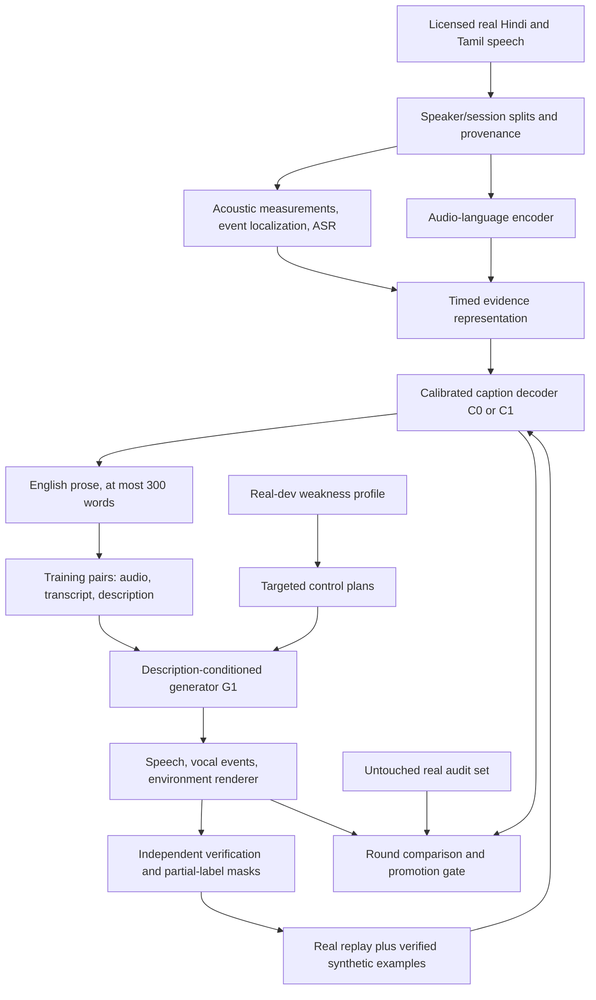

# Proposed architecture for Inter IIT Rime Track 2

**Hardware correction:** this historical draft assumed T4 GPUs. The user has clarified **4×L4 GPUs with 24 GB VRAM each**. Use [architecture v4](ARCHITECTURE_V4.md) and the [current experiment plan](EXPERIMENTS.md) for corrected hardware, precision and memory guidance.

**Historical initial proposal; [ARCHITECTURE_V3.md](ARCHITECTURE_V3.md) is current.** Version 2 superseded this after the first pass; version 3 adds ten detailed main-text reviews and revises the architecture and budget. Indic Parler-TTS precedes IndicF5 adapter development in the generator comparison. The zero-paper statement below describes the initial draft; see [first-pass status](REVIEW_STATUS.json) and [additional-pass status](reviews/round2/STATUS.json).

## Recommendation and confidence

Build a **grounded captioner and a controllable Hindi/Tamil generator connected by a verified, weakness-targeted training loop**. Share an internal timed representation between them, while preserving free-form English descriptions at their public interfaces. Use one complete improvement round before spending on a second.

For the stated hardware, start with an Audio Flamingo 3 7B caption backbone using quantization and adapter training, and an IndicF5 speech backbone augmented with learned description conditioning and temporal controls. These are engineering starting points, not demonstrated winners. A Hindi/Tamil description-native checkpoint such as Indic Parler-TTS is an important alternative to verify when its model card and weights are reachable. Do not choose a winner by an English leaderboard or a repository's own quality claim.

The research contribution should be **learning from verified acoustic interventions, with per-attribute reliability and a curriculum targeted at real captioning errors**. Whether this is novel relative to published work remains an open question until the literature review is complete. The PS itself already suggests controlled transformations and targeted synthetic examples; implementing those suggestions alone is not a novelty claim.

## What the scoring actually rewards

The PS's Track 2 section and Appendix F specify:

| Requirement | Architectural consequence |
|---|---|
| Captioner accepts one audio file, at most 30 seconds; returns English free text | Preserve one absolute time axis; produce compact prose rather than exposing internal JSON |
| Description is truncated at 300 words | Budget words by supported information; do not place all timed events after a long introduction |
| Voice/sound, recording/ecology, intent axes are all required | Use independent evidence channels and explicit coverage checks across all three |
| Correct details earn credit; false or contradicted details lose credit | Calibrate assertions and suppress unsupported detail; verbosity is not the objective |
| Timed items receive ±250 ms tolerance around the hidden rubric span | Train event localization and test timing error, not just global caption similarity |
| Generator accepts text and description, without a reference recording | Any reference-dependent backbone needs an internal voice prior; requiring a caller-supplied reference is invalid |
| Output sample rate is at least 24 kHz | Native 24 kHz synthesis and correctly sampled effects; upsampling cannot recover missing detail |
| Ten generations per description, with relevant speaker diversity | Vary identity between samples while keeping it stable within each clip |
| At least one loop round after round 0 | Show C0 → caption pool → G1 → targeted synthesis → C1, with all intermediate evidence |
| Open submitted models; automatic outputs | All runtime modules and weights must be eligible and self-contained; no manual output selection |

Measured results are description 10, instruction relevance 5, naturalness 2, diversity 2, and intelligibility 1 points. The other 80 competition points cover research process, test sets, evidence, reproducibility, and presentation. This favors a focused causal experiment with a reliable loop over an untested collection of large models.

The PS's diversity formula and the sentence “one voice for every description scores 0” need organizer clarification: the direct distinct-count formula appears to assign a positive value to one distinct passing speaker. Also confirm the exact verification model, threshold, clustering/counting rule, aggregation, and Track 2 bootstrap keys. Record both plausible local interpretations until clarified; do not silently alter the official scoring.

## End-to-end system



Training helpers may be larger or more numerous than runtime components. Keep the final automatic pipeline compact. A text-only LLM may help training label rewriting; it must not invent acoustic evidence. Do not backpropagate through a circular C/G agreement score and treat agreement as truth.

## 1. Data and provenance

Use Vaani Hindi/Tamil as the main spontaneous-speech pool, supplemented by licensed clean Indian speech and appropriately licensed nonverbal/environmental recordings. The approximate pool sizes in the PS are not a requirement to process all hours. Select a manageable, balanced subset. Do not convert the raw 14,900:850 hour imbalance into the training distribution.

Partition original recordings **before** segmentation, augmentation, captions, or synthesis. Group by speaker, recording session, source, and near-duplicate cluster. Every derivative inherits its parent's split. Use audio fingerprinting and transcript similarity to detect cross-source duplicates; ASR text matching alone is insufficient. Keep the contributed competition set separate from all model development.

Maintain four data partitions:

1. Training pool, including a small native-listener-checked seed subset.
2. Calibration/development set, used for thresholds, curriculum selection, and checkpoint selection.
3. Real audit set, held back from those choices and used only at predeclared milestones.
4. Contributed mid-term evaluation clips and generation descriptions, excluded from training and tuning.

Do not keep adding hard examples to a supposedly fixed test set. Maintain a fixed comparable dev core and a separately versioned expanding challenge set. Report results on both. If an audit set is repeatedly used for architectural decisions, it has become development data and needs a new final audit set.

Example manifest fields:

```text
example_id, original_id, parent_ids, audio_sha256, transcript_sha256,
source_uri, source_revision, license, permitted_uses, language,
speaker_group, session_group, split, original_sample_rate, duration_s,
labeler_kind, labeler_model_revision, human_review_status,
caption_revision, valid_attribute_mask, transform_recipe_hash,
generator_checkpoint_hash, seed, measured_quality, consent_record_id
```

Store label confidence and evidence **per claim**, not just per example. A reliable added-noise annotation does not make inferred speaker age, accent, or intent reliable. Record training examples from closed teachers if used; no closed teacher belongs inside the submitted inference path. Prefer open teachers for auditability and reproducibility.

## 2. Shared timed evidence representation

Use an internal representation with global claims, intervals, and relations. It is an implementation structure, not a fixed public taxonomy. Preserve free-form residual text for unusual sounds and fantastical compositions.

```json
{
  "language": "ta",
  "duration_s": 8.4,
  "global": {
    "speaker": {"audible_traits": "adult, mid-low voice", "confidence": 0.86},
    "channel": {"claim": "close microphone", "confidence": 0.75}
  },
  "segments": [
    {"start_s": 0.0, "end_s": 2.8,
     "claims": [
       {"type": "timing", "value": "accelerates", "evidence": "rate_track"},
       {"type": "pitch", "value": "rising phrase peaks", "evidence": "voiced_f0"}
     ]}
  ],
  "relations": [],
  "unknown": ["exact_room_dimensions", "biographical_age"],
  "free_form_residual": ""
}
```

The numbers in this schema illustrate a format, not measurements. Confidence must be calibrated on real labeled examples before it influences output selection.

Each claim carries axis/type, interval where relevant, raw evidence reference, confidence, origin, and validity mask. Relations include before/after, overlap, and response-to. Temporal association alone must not create a causal response label. These relations support the ecology “Coupling” and intent “Change” types, which global tags miss.

Never force every clip to have every event. A quiet read sentence should have a short accurate description. All three axes should be addressed only to the extent supported: describing a plain reading as straightforward delivery is useful; inventing a listener or a hidden emotion is not.

## 3. Captioner

### Evidence front end

Retain the original signal for inference. Make model-specific resampled views with a correct time mapping. Denoising, if used for ASR, is an auxiliary view: feeding only denoised audio destroys ecology evidence.

Run lightweight measurements, cached during training:

- VAD and pause/breath candidates; use a native Hindi/Tamil ASR/alignment system for word timing and lexical context. AI4Bharat IndicConformer is the PS's official CER evaluator, but model availability and local compatibility still need verification.
- F0 with voiced/unvoiced confidence, octave-error screening, voiced quantiles, and phrase contours. Report semitone changes as `12 log2(f2/f1)`; define the reference for relative tracks.
- Loudness/envelope, spectral tilt/brightness, periodicity and voicing proxies. Do not call gain “vocal effort,” and do not trust pitch during whispers, creak, overlapping noise, or unvoiced segments.
- An event detector with frame-level outputs for laughter, breath, clicks, interruptions, and background sounds. PANNs is a documented candidate; evaluate local resolution before relying on it for ±250 ms scoring.
- Conservative channel/room evidence. Band limitation can be observed; an exact phone model, microphone distance, room material, or wall dimensions usually cannot be inferred reliably.

For each measurement return uncertainty and failure flags. Numerical precision must match signal support: “about 200 Hz” or “roughly 350 ms” is preferable to spurious exactness. High-confidence negative claims such as “no music” also require evidence.

### Backbone and fusion

Audio Flamingo 3's documented architecture combines AF-Whisper, an MLP audio adaptor, and Qwen2.5-7B. It is a reasonable budget candidate, with an explicit Hindi/Tamil grounding test before selection. Its published broad audio ability does not establish native-language understanding or accurate intent inference.

Start with the frozen audio encoder and quantized LLM, training the projector and LoRA adapters. Encode the evidence track as compact time-stamped tokens. Keep ASR text in a separate marked field so it cannot be mistaken for sound evidence. Use a small temporal head over audio frames to propose boundaries; use discrete source-time bins plus finer local offsets rather than relying solely on a language model to invent timestamps.

The initial implementation can serialize evidence into a prompt. Trainable evidence-token fusion and a temporal head are later additions only if their paired ablations justify the cost. This keeps a functioning baseline available while research proceeds.

Two decoder stages may share one model:

1. Propose claims and evidence links.
2. Select supported claims and verbalize concise English prose.

The writer can use at most 280 words as an engineering buffer below the 300-word limit. Count the final rendered text, including numbers/timestamps, with a conservative tokenizer and whitespace count. Avoid a hard truncation that cuts sentences or systematically drops intent.

### Training and calibration

Train on verified captions, grounded question/answer tasks, correct-vs-false claim pairs, and counterfactual audio pairs. Balance simple clips with complex clips; otherwise the model learns to fabricate dramatic events on ordinary speech.

A proposed objective is:

`L_C = L_caption + λ_t L_time + λ_f L_false_claim + λ_d L_delta + λ_r L_real_replay`.

This is a design proposal; weights and gains are unmeasured. `L_delta` requires changing the transformed property while preserving only properties known to remain unchanged. Intent is not automatically invariant under every acoustic transformation.

On human-checked dev claims, fit per-type/language confidence calibration and select assertion thresholds. Under a simplified reward model, assert a claim when `p*w - (1-p)*v > 0`, where `w` is its potential reward and `v` its false-claim penalty; the threshold is `v/(w+v)`. Hidden rubric weights are unknown, so use a sensitivity analysis rather than pretending this computes official optimal behavior. Avoid printing guesses between alternatives; the PS does not award them as committed statements.

## 4. Generator

### Backbone selection

IndicF5's official README documents Hindi and Tamil support, reference-audio conditioning, and a 24 kHz output example. It provides a stronger language prior than assuming Qwen3-TTS supports an unlisted language. It is **not** already a free-description-controlled Track 2 solution.

Qwen3-TTS's official documentation lists ten supported languages, without Hindi or Tamil; CustomVoice also exposes a limited named-speaker set. Treat it as an optional measured baseline or teacher, not the unquestioned final generator. Qwen VoiceDesign and Base have different interfaces from CustomVoice.

Before implementing adapters, compare:

1. A verified Hindi/Tamil description-native checkpoint, if available and eligible.
2. IndicF5 plus a deterministic description-to-internal-reference selector, as a limited baseline.
3. IndicF5 with learned global and temporal conditioning, as the proposed research system.

For the reference-based options, ship a consented/licensed **training-only** reference bank with transcripts and broad voice coverage. The public API still accepts only text and description. Do not retrieve evaluation recordings or use a submitted speaker's consented evaluation clip as training material. If exact identity is not requested, sample among compatible internal voices; log the choice and seed. A finite bank limits diversity and warrants testing a learned style/identity prior, not a claim of unlimited new identities.

### Description compiler and controls

Compile the description into a plan containing global identity constraints, linguistic content, timed delivery changes, vocal events, room/channel parameters, background sources, and interaction relations. Preserve unusual instructions in free text for cross-attention; parsing into a closed tag list would fail the PS's open-ended requirement.

Separate controls:

- **Global voice code**, sampled once per clip, controls stable timbre/identity.
- **Temporal delivery code** controls F0 tendencies, rate, emphasis, phonation, and phrase transitions.
- **Vocal event plan** schedules breath/laugh/click/whisper transitions in the same voice.
- **Environment plan** controls room response, channel, and background events.
- **Coupling plan** jointly schedules environmental events and the speaker's response.

The content transcript and spoken text must remain exact. The compiler must not translate, paraphrase, add stage directions as spoken words, or confuse instruction numbers with text to speak.

F5-TTS's inspected DiT code concatenates noisy mel, reference-conditioning mel, and text embeddings, and uses transformer blocks. Proposed extension: add a compact description encoder with zero-initialized gated residual cross-attention in selected blocks; add a frame-aligned control projection for delivery/event plans. Freeze most pretrained weights initially. Train adapters plus selected projections. These changes require implementation and empirical testing; they are not upstream features.

Because F5 text conditioning does not supply guaranteed phoneme-to-frame alignment, add a duration/alignment module when exact local control needs it. Use training alignments, a total-length predictor, and explicit pause/event slots. Do not claim that appending a timestamp to a prompt produces an event at that time. Avoid independently generating tiny chunks whose joins introduce voice drift and artefacts; prefer whole-utterance conditioning, or overlap/inpainting with a persistent voice state.

### Acoustic rendering

Produce speech natively at 24 kHz. Render controllable room/channel effects and environmental sources at the same or higher rate and downsample correctly. Deterministic DSP provides exact control for supported transformations, but cannot substitute for learned whisper, vocal effort, laughter, or accent.

For the simplest supported background sounds, retrieve licensed assets or synthesize a known signal. Broader free-form backgrounds require an eligible pretrained text-to-audio model; its availability, memory, and license must be checked before inclusion. Keep this branch optional until the core speech and caption loop works, while reporting the unsupported coverage honestly. Fantastical descriptions are a real risk for a modular speech-first system, not a solved capability.

Use a shared event clock. If a whistle begins at 7 seconds, its onset and any requested louder/brighter response share that timeline. Merely adding noise to fixed speech does not generate a Lombard response. Keep peak headroom; do not normalize away requested relative loudness changes. Preserve one consistent speaker across all vocal events.

### Generator training

Use measured real `(text, description, audio)` pairs for learned description conditioning. Synthetic transformations provide additional valid controls. A proposed objective is conditional flow matching plus masked auxiliary alignment/control losses:

`L_G = L_flow + λ_a L_alignment + λ_p L_pitch/rate + λ_s L_identity + λ_c L_control`.

Apply losses only where labels are valid. Some may be offline selection criteria rather than differentiable losses, depending on implementation. Do not imply an ASR CER metric is automatically differentiable. ASR reward optimization and adversarial speaker-diversity losses are later experiments, not required first-round components.

For ten samples, fix the requested constraints and sample ten seeded identity/style latents or compatible reference choices. Avoid using just temperature to obtain apparent identity diversity. Verify within-clip consistency separately from between-sample diversity. Do not ship a runtime best-of-N rejection loop without an explicit evaluation-rule check; the default emits the ten predeclared seeds with no manual selection.

## 5. The recursive learning experiment

### Round 0

Freeze C0 and G0, their wrappers, prompts, tokenizer revisions, quantization settings, seeds, and hashes. A wrapper can provide evidence extraction and internal reference selection, but its limitations must be reported. Do not train an improved model and retroactively call it round 0.

### Round 1

1. C0 captions the real training pool. Independent measurements and a sampled human audit establish per-claim reliability.
2. Train G1 on the expanded, filtered `(audio, text, description)` pool. Record which examples came from C0, people, tools, and external teachers.
3. Measure C0 errors on development data by language, axis, item type, and relevant interactions. Keep the audit set untouched.
4. Choose target conditions that address those errors and that G1 can actually render. Include random and easy targets to avoid an unstable all-hard curriculum.
5. G1 generates speech; independent tools and training-time listeners check whether each target happened. Verify the realized audio, not just the input instruction.
6. Train C1 on real replay plus verified synthetic examples, masking unverified attributes. The **realized** description, not an aspirational prompt, is the label.
7. Compare C1/G1 with C0/G0 on real held-out data, with controlled alternatives and confidence intervals. Promote only if gains survive false-claim and language-regression checks.

A second round is optional and should be launched only after diagnosing useful residual error and estimating benefit per GPU-hour.

### Curriculum

For a condition group `k`, use a capped priority proportional to:

`real_dev_error(k) × estimated_target_importance(k) × generator_pass_rate(k) / generation_cost(k)`.

Importance is a declared local proxy for rubric coverage, not a leaked hidden score. Smooth noisy small groups, cap any one group, balance Hindi/Tamil, reserve ordinary speech, and track coverage of rare combinations. An apparent gain from synthesizing unverifiable extreme cases is not useful supervision.

### Transformations and what they do not prove

| Intervention | Labels it can support | Labels it cannot establish by itself |
|---|---|---|
| Add a known source with known onset/gain | Source identity/onset, mixing gain; SNR if defined and measured | Speaker reacts to it; intent; room identity |
| Convolve with a known measured RIR | Applied impulse response and its measured properties | Exact room materials or microphone distance from a reverberant mixture |
| Time stretch, pitch-preserving and checked | Requested rate/duration change | Excitement, anger, unchanged perceived intent |
| Pitch shift | Approximate applied pitch delta after measurement | Falsetto, age, gender, accent, natural vocal effort |
| Gain change | Signal level change | Shouting or Lombard effect |
| Insert a laugh asset at a known span | Audible laugh and verified realized span | Same speaker identity or self-mocking intent without further evidence |
| Apply a codec/filter | Known channel processing | Specific phone hardware or an actual telephone-call setting |

Audit clipping, overlap, masking, tails, and pitch-tracker failure after rendering. Use several effect implementations so C1 cannot solve tasks by recognizing one synthetic artefact. Hold out transformation families/settings to test generalization.

## 6. Runtime contracts and reproducibility

Design interfaces:

```text
caption(audio_path, checkpoint, seed) -> English description
generate(native_text, description, checkpoint, seed) -> >=24 kHz WAV
evaluate(round_manifest, real_split, fixed_evaluator_revisions) -> metrics + raw evidence
```

These are planned interfaces, not commands that currently exist. The generator must not require a reference recording from the evaluation item. Use a versioned text normalizer and Unicode handling; preserve the native-script source text for official CER. Do not apply Track 1-specific normalization rules to Track 2 without support.

Pin every external repository/model/dataset revision, record licenses and preprocessing, include all prompts, maintain a GPU-hour ledger including failed experiments, and store per-item outputs with hashes. Log all ten seeds. Separate training verifiers from final independent evaluators. Freeze before evaluation inputs are released, lock raw outputs, and do not edit or choose outputs after inspecting official feedback.

## Decision

The strongest current recommendation is the **verified targeted loop**, with an acoustically grounded captioner and a speech-first generator that explicitly models timing, identity, and ecology. The backbone decision is provisional. The next decisive evidence is: completed core-paper reading, native Hindi/Tamil baseline tests, T4 compatibility/memory profiling, and a small controlled intervention experiment. No available evidence supports calling any architecture “the best possible” before those comparisons.
